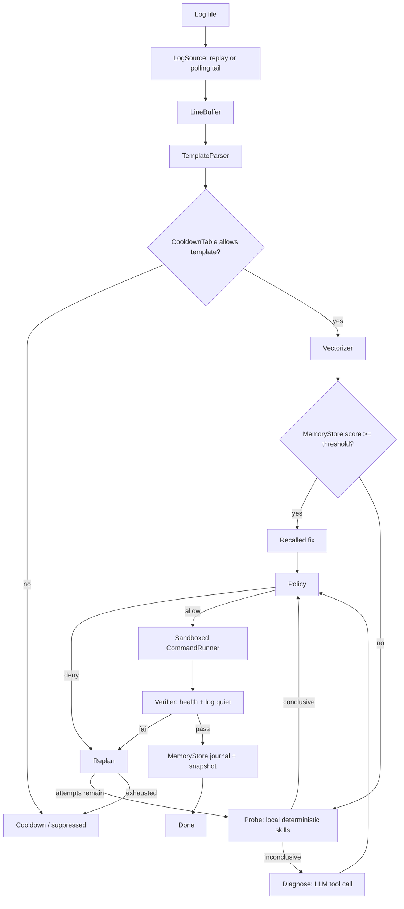
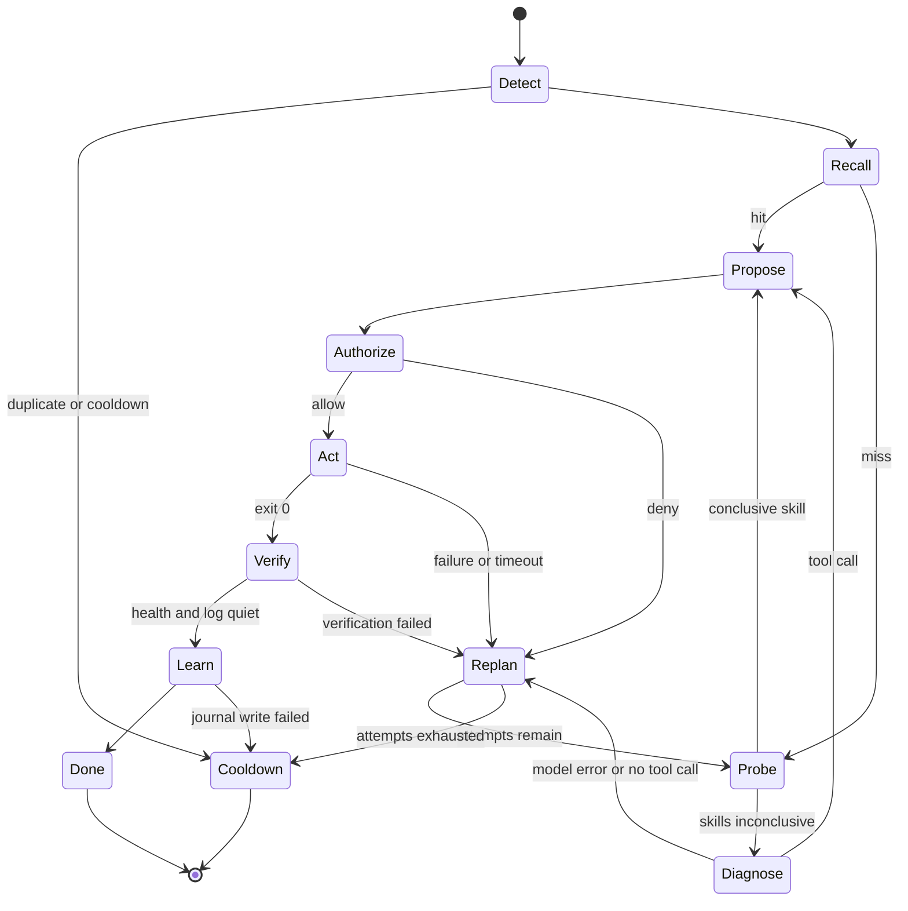

# agenticpp: A Fast, Memory-Efficient Log Repair Agent

## Executive Summary

`agenticpp` is a bounded agentic log-repair daemon written in C++20. It tails a service log, masks volatile fields into stable templates, recalls a previously verified repair from a compact local vector store, and asks a language model only when local evidence is insufficient. Every proposed command passes a deterministic allowlist, runs in a bounded child process, and enters durable memory only after health and log-quiet verification pass.

The performance thesis is:

1. **Known failures should not pay for an LLM round trip.** The deterministic Probe and recall paths resolve known incidents in roughly 0–1 ms, versus roughly 0.8–0.9 s for a real LLM decision.
2. **Local retrieval should be compact and predictable.** The in-memory vector store is a contiguous `float` matrix, 512 dimensions per record, with AVX2/FMA runtime dispatch.
3. **End-to-end repair latency is intentionally dominated by verification, not by ingestion or language runtime.** A 3-second log-quiet window is a deliberate stability check.

Measured on the current working tree:

| Finding | Measurement |
| --- | --- |
| Port-conflict skill decision | `first_proposal_ms=1` |
| Learned recall decision | `first_proposal_ms=0` |
| Real DeepSeek decision, base port case | `first_proposal_ms=768` |
| Real DeepSeek decision, new incident | `first_proposal_ms=919` |
| Full repair, skill/recall path | `total_ms≈3.0 s` |
| Full repair, real LLM base case | `total_ms=3.77 s` |
| Hard two-attempt case | `total_ms≈6.0 s` |
| C++ 10k retrieval, scalar | `2.91 ms` |
| C++ 10k retrieval, AVX2 dispatch | `1.35 ms` |
| Python stdlib list 10k retrieval | `143.98 ms` |
| Python flat `array('f')` 10k retrieval | `247.62 ms` |
| C++ 10k peak RSS | `30.1 MB` |
| Naive Python list 10k RSS | `208.3 MB` |
| Python flat `array('f')` 10k RSS | `30.6 MB` |
| Idle daemon RSS | `11.1 MB` |

The honest conclusion is:

> The daemon is much faster than a naive Python object-per-float implementation for local retrieval, and it avoids an LLM round trip on known incidents. It is **not** 10× faster end to end than every Python implementation, because command execution and the 3-second log-quiet window dominate full repair time. A Python implementation using NumPy or `array('f')` has comparable memory to the C++ vector store.

## Scope of the Performance Claim

There are three distinct quantities in this report:

- **`first_proposal_ms`** — time from `Detect` to the first `Propose`. This isolates the decision path: Probe/skill, recall, or LLM.
- **`total_ms`** — time from `Detect` to `Done` or `Cooldown`. This includes command execution, health probing, and the log-quiet dwell window.
- **Retrieval time** — a full top-k cosine scan over stored vectors, measured by `bench_search`.

Do not use `total_ms` alone to claim a language-level speedup. A correct comparison must either:

- compare `first_proposal_ms` and LLM-call count, or
- compare the same full workflow, including the same verification policy, in both implementations.

## System Overview

The deterministic data path runs for every incident. The model-assisted path runs only when deterministic probes are inconclusive or a previous attempt failed.



The Agent is a bounded phase machine:



## What Makes It Fast

### 1. Probe skills avoid the model for known failure shapes

The deterministic skills are:

| Skill | Evidence | Fast-path proposal |
| --- | --- | --- |
| `port_conflict` | TCP LISTEN state, live decoder pidfile | `scripts/kill-decoy.sh` |
| `config_invalid` | captured project-local config path, JSON parse | `scripts/fix-config.sh` |
| `service_state` | victim pidfile, process liveness, port state | `scripts/restart-victim.sh` when down |
| `recent_occurrences` | topic count in recent log bytes | evidence only |

The port demo is resolved with `first_proposal_ms=1`; the validated repair has no LLM call, no network wait, and no token cost.

### 2. Recall avoids the model after one successful repair

A durable `MemoryStore` journal and snapshot preserve learned fixes. A second occurrence of the same template takes the recall path:

```text
first_proposal_ms=0
```

There is no `[DIAGNOSE]` and no LLM call. The measured learned case spent its time in command execution and the 3-second log-quiet check, not in decision making.

### 3. Compact contiguous retrieval

The vector store is:

```text
records: unordered_map<template_id, record metadata>
ids:     contiguous vector<uint64_t>
vectors: contiguous vector<float>, n × 512
```

Each vector costs `512 × 4 = 2048` bytes, plus an 8-byte id and small metadata. There is no per-float Python object, no per-row list, and no interpreter object graph in the search loop.

### 4. AVX2/FMA with scalar fallback

`cosine_topk_scalar` is portable. `cosine_topk_avx2` uses 8-wide FMA and a scalar tail. Runtime dispatch checks AVX2 and FMA once. Only the AVX2 translation unit is compiled with `-mavx2 -mfma`, so the fallback remains portable and the dispatch remains honest.

## Measurement Setup

- Host: Intel Core Ultra 5 125H, 18 logical CPUs
- OS: Linux `6.18.63` x86_64
- Build: `release` (`RelWithDebInfo`, LLM on)
- Date: 2026-11-19
- Retrieval workload: 512-dimensional random normalized vectors, top-k = 3
- Python baseline: `tools/bench_python_baseline.py`, standard library only
- Python list mode: a list of Python float objects per row
- Python array mode: one flat `array('f')`
- C++ RSS: `/usr/bin/time -v` peak resident set size
- Python RSS: `resource.getrusage(RUSAGE_SELF).ru_maxrss`
- LLM timings: real DeepSeek base/new cases; cassette for the deterministic hard case

Run the benchmark:

```bash
./scripts/bench-report.sh
```

The numbers vary with CPU frequency and host load. The report uses medians across the measured iterations and labels the few single-iteration RSS measurements.

## Speed Results

### Agent decision and full repair

Measured with:

```bash
LLM=deepseek ./scripts/demo-llm-cases.sh
```

| Case | Decision path | `first_proposal_ms` | `total_ms` |
| --- | --- | ---: | ---: |
| Port conflict, skill enabled | local skill | 1 | 3005 |
| Port conflict, empty store, real LLM | real DeepSeek | 768 | 3771 |
| Port conflict, learned store | recall | 0 | 3003 |
| New incident, real LLM | real DeepSeek | 919 | 3922 |
| Hard port conflict, two attempts | cassette | 3 | 6008 |

Interpretation:

- Local skill and recall decisions are effectively immediate.
- The LLM round trip adds roughly 0.77–0.92 seconds to the decision phase.
- Every successful path still pays the 3-second log-quiet window.
- The hard case pays the verification window twice, which is why it is approximately 6 seconds.
- These numbers do not support the claim that C++ makes the whole repair 10× faster. They support the narrower claim that the daemon avoids an LLM round trip on known or locally diagnosable incidents.

### Retrieval: C++

`./scripts/bench-report.sh` produced:

| n | Scalar p50 | AVX2 dispatch p50 | Scalar p99 | AVX2 p99 | Peak RSS |
| ---: | ---: | ---: | ---: | ---: | ---: |
| 1,000 | 0.227 ms | 0.044 ms | 0.264 ms | 0.051 ms | — |
| 10,000 | 2.906 ms | 1.351 ms | 3.531 ms | 1.614 ms | 30.1 MB |
| 100,000 | 33.053 ms | 11.827 ms | 36.854 ms | 18.412 ms | 210.5 MB |

AVX2 speedup in this run: roughly 5.2× at 1k, 2.2× at 10k, and 2.8× at 100k. Earlier runs reached larger ratios; report the measured range, not the best single run.

### Retrieval: Python standard-library baseline

`tools/bench_python_baseline.py` performs a pure Python full scan. It is not NumPy.

| n | Mode | Search p50 | Peak RSS |
| ---: | --- | ---: | ---: |
| 1,000 | list of floats | 13.84 ms | 31.0 MB |
| 1,000 | flat `array('f')` | 24.01 ms | 13.9 MB |
| 10,000 | list of floats | 143.98 ms | 208.3 MB |
| 10,000 | flat `array('f')` | 247.62 ms | 30.6 MB |
| 100,000 | flat `array('f')` | 2536.58 ms | 206.3 MB |

Approximate ratios at 10k:

| Comparison | Ratio |
| --- | ---: |
| C++ scalar vs Python list | 49.5× faster |
| C++ AVX2 vs Python list | 106.6× faster |
| C++ scalar vs Python flat array | 85.2× faster |
| C++ AVX2 vs Python flat array | 183.3× faster |

At 100k, C++ AVX2 is about 214× faster than the flat-array Python loop.

The Python flat array is slower than the list in this specific pure-Python loop because `array` indexing creates Python float objects on every access. The comparison is about language/runtime overhead, not a universal claim about all Python implementations.

### Memory results

| Workload | Peak RSS |
| --- | ---: |
| Idle `agentd` (release, follow, no LLM) | 11.1 MB |
| Bare Python interpreter | 8.7 MB |
| C++ 10k vector store benchmark | 30.1 MB |
| Python list 10k vectors | 208.3 MB |
| Python flat `array('f')` 10k vectors | 30.6 MB |
| C++ 100k vector store benchmark | 210.5 MB |
| Python flat `array('f')` 100k vectors | 206.3 MB |

Interpretation:

- Against a **naive Python list of floats**, the C++ vector store uses about **6.9× less peak memory** at 10k records.
- Against a **flat Python `array('f')` or NumPy `float32` matrix**, memory is essentially comparable. The C++ code does not magically beat a compact array.
- The C++ advantage is the absence of a Python interpreter, per-float objects, per-row lists, and dynamic dispatch in the scan, not a different asymptotic memory complexity.
- The idle daemon RSS is 11.1 MB; a bare Python interpreter is 8.7 MB. A real Python agent would add libraries, an HTTP client, JSON state, and an object-per-record store. The vector-store comparison is the more meaningful memory finding.

The theoretical vector payload is:

```text
512 floats × 4 bytes = 2,048 bytes per record
+ 8 bytes template id
+ strings/argv/purpose metadata
```

At 10k records the vector matrix alone is about 20 MB; the benchmark peak RSS of 30.1 MB includes the matrix, query, top-k buffers, and process overhead.

## What This Report Does and Does Not Claim

Supported claims:

- Known failure classes can be diagnosed and repaired without an LLM call.
- Learned incidents take the recall path with `first_proposal_ms=0`.
- The C++ contiguous vector store with AVX2 is substantially faster than a naive pure-Python full scan.
- The vector store is compact and predictable: 2 KB per 512-dimensional float vector.
- The C++ implementation avoids a Python runtime and per-float object overhead.

Unsupported claims:

- “The whole repair is 10× faster than Python.” End-to-end repair is dominated by command execution and the 3-second log-quiet verification.
- “The C++ store uses less memory than any Python implementation.” A flat `array('f')` or NumPy matrix is comparable.
- “The LLM is always slower.” Some Python implementations may not use an LLM at all; the relevant comparison is the same policy, probes, execution, and verification.
- “The current daemon is a general autonomous agent.” It is a bounded, domain-specific repair agent.

## Correctness and Safety Context

Speed only matters because the repair is still gated:

- `Policy` accepts only resolved allowlisted argv, rejects symlinks, traversal, NUL bytes, and out-of-root absolute arguments.
- `ChildProcessRunner` uses `execve`, process groups, rlimits, output caps, and a minimal environment.
- Sandbox tiers add user/mount namespaces, a chrooted tmpfs root, optional network isolation, and a seccomp allowlist.
- `LogQuietVerifier` catches “health is 200 but the error is still logging.”
- `Replan` is bounded; duplicate argv is rejected.
- `CooldownTable` prevents repeated incidents from flooding the model or command runner.
- Durable memory is written only after verification.

## Implementation Map

| Area | Files |
| --- | --- |
| Log ingestion | `include/agenticpp/log_source.hpp`, `src/log_source.cpp`, `include/agenticpp/line_buffer.hpp`, `src/line_buffer.cpp` |
| Templates | `include/agenticpp/template_parser.hpp`, `src/template_parser.cpp` |
| Vectorization and search | `include/agenticpp/vectorizer.hpp`, `src/vectorizer.cpp`, `include/agenticpp/cosine.hpp`, `src/cosine.cpp`, `src/cosine_avx2.cpp` |
| Durable memory | `include/agenticpp/memory_store.hpp`, `src/memory_store.cpp`, `include/agenticpp/memory_journal.hpp`, `src/memory_journal.cpp` |
| Agent and orchestration | `include/agenticpp/agent.hpp`, `src/agent.cpp`, `include/agenticpp/cooldown.hpp`, `src/cooldown.cpp` |
| Local skills | `include/agenticpp/skills.hpp`, `src/skills.cpp` |
| Policy and execution | `include/agenticpp/policy.hpp`, `src/policy.cpp`, `include/agenticpp/executor.hpp`, `src/executor.cpp` |
| Verification | `include/agenticpp/verifier.hpp`, `src/verifier.cpp` |
| Concurrency | `include/agenticpp/incident_queue.hpp`, `src/incident_queue.cpp` |
| Demo and tests | `apps/agentd.cpp`, `scripts/`, `tests/`, `tools/bench_python_baseline.py` |

## Testing Commands

Run everything from the repository root.

### Build

```bash
cmake --preset debug
cmake --build --preset debug
```

The LLM build:

```bash
cmake --preset debug-llm
cmake --build --preset debug-llm
```

The second compiler:

```bash
cmake --preset gcc-debug
cmake --build --preset gcc-debug
```

ThreadSanitizer:

```bash
cmake --preset tsan
cmake --build --preset tsan
```

Release/benchmark:

```bash
cmake --preset release
cmake --build --preset release
```

### Full test matrix

```bash
ctest --preset debug
ctest --preset gcc-debug
ctest --preset debug-llm
ctest --preset tsan
ctest --preset release
```

Current expected counts:

```text
debug       144/144
gcc-debug   144/144
debug-llm   149/149
tsan        144/144, 4 sandbox tests skipped
release     149/149
```

### Component tests

```bash
ctest --preset debug -R "LineBuffer"
ctest --preset debug -R "LogSource:"
ctest --preset debug -R "TemplateParser"
ctest --preset debug -R "Vectorizer|MemoryStore"
ctest --preset debug -R "MemoryJournal"
ctest --preset debug -R "Policy"
ctest --preset debug -R "Executor:"
ctest --preset debug -R "Verifier:"
ctest --preset debug -R "Agent:"
ctest --preset debug -R "Cosine"
ctest --preset debug -R "Skills:"
ctest --preset debug -R "CooldownTable"
ctest --preset debug -R "IncidentQueue|concurrent"
ctest --preset debug -R "Sandbox"
```

### CLI checks

```bash
./build/debug/bin/agentd --check-command scripts/kill-decoy.sh
./build/debug/bin/agentd --check-command -- sh -c 'rm -rf /'
./build/debug/bin/agentd --check-command scripts/../../etc/passwd
./build/debug/bin/agentd --check-command scripts/kill-decoy.sh extra
```

Expected:

```text
ALLOW rule=kill-decoy reason=resolved allowlist match
DENY rule= reason=program is on deny list: sh
DENY ... traversal
DENY rule=kill-decoy reason=too many arguments
```

### Replay scenarios

```bash
./scripts/demo.sh port-conflict
./scripts/demo.sh crash
./scripts/demo.sh oom
./scripts/demo.sh duplicate
./scripts/demo.sh unfixable
./scripts/demo.sh all
```

Each prints a `[timing] scenario=... total_ms=...` line. The `all` mode also proves learning across the scenario sequence; use a fresh memory store when you want a cold run:

```bash
rm -f data/memory.bin data/memory.journal
```

### Live three-terminal demo

Terminal 1:

```bash
cd /home/ryuji/Documents/Projects/agenticpp
./scripts/live-demo.sh
```

Terminal 2:

```bash
tail -F data/memory.journal
```

Terminal 3:

```bash
./scripts/inject-port-conflict.sh
./scripts/inject-service-crash.sh
./scripts/inject-oom.sh
./scripts/inject-duplicate.sh
./scripts/inject-unfixable.sh
```

If port 18080 is busy:

```bash
VICTIM_PORT=18081 ./scripts/live-demo.sh
VICTIM_PORT=18081 ./scripts/inject-port-conflict.sh
```

The live demo prints an Agent `[TIMING]` line for each incident. The scripts also generate a temporary config with the matching health URL when a non-default port is used.

### Live scenario matrix

```bash
./scripts/test-live-scenarios.sh
```

Expected:

```text
[live-test] PASS: port-conflict
[live-test] PASS: crash
[live-test] PASS: oom
[live-test] PASS: duplicate
[live-test] PASS: unfixable
[live-test] PASS: all live scenarios
```

It also prints:

```text
[timing] live=port-conflict repair_ms=... total_ms=...
```

### LLM decision cases

With the local key file:

```bash
LLM=deepseek ./scripts/demo-llm-cases.sh
```

Deterministic cassette mode:

```bash
LLM=cassette ./scripts/demo-llm-cases.sh
```

Expected four cases:

```text
1. base port conflict → Diagnose → LLM → kill-decoy → Done
2. learned port conflict → recall hit → no Diagnose → Done
3. new incident → Diagnose → LLM → restart-victim → Done
4. hard port conflict → Replan → kill-decoy → Done after 2 attempts
```

The hard case deliberately uses `tests/data/hard-port.replies.json`; the first reply restarts the victim without freeing the decoy port, and the second frees the port.

### Full system test

```bash
./scripts/test-system.sh
```

Run every preset and all demo matrices:

```bash
MATRIX=1 LLM_CASES=1 ./scripts/test-system.sh
```

Expected final line:

```text
[system] PASS: full system test completed
```

### Retrieval benchmark

```bash
./scripts/bench-report.sh
```

Individual commands:

```bash
./build/release/bin/bench_search --n 10000 --iters 20
./build/release/bin/bench_search --n 100000 --iters 5
python3 tools/bench_python_baseline.py --n 10000 --dim 512 --iters 3 --mode list
python3 tools/bench_python_baseline.py --n 10000 --dim 512 --iters 3 --mode array
```

Peak RSS:

```bash
/usr/bin/time -v ./build/release/bin/bench_search --n 10000 --iters 1
/usr/bin/time -v ./build/release/bin/bench_search --n 100000 --iters 1
```

### Live RSS measurement

```bash
: > /tmp/empty.log
./build/release/bin/agentd --follow /tmp/empty.log --dry-run --no-llm --workers 1 &
pid=$!
sleep 1
grep VmRSS /proc/$pid/status
kill -INT $pid
wait $pid
```

### Timing interpretation

`[TIMING]` from the Agent:

```text
[TIMING] template=... total_ms=3771 first_proposal_ms=768
```

- `first_proposal_ms` is the decision metric.
- `total_ms` includes the 3-second log-quiet window and command execution.
- Learned recall has `first_proposal_ms=0`; real LLM decisions were 768–919 ms; the skill fast path was 1 ms.

## Known Limitations

- Full repair latency is dominated by the deliberate 3-second log-quiet window. A Python implementation with the same verifier would pay the same cost.
- The hard LLM case uses a cassette so the first failed verification is reproducible. The base and new-incident cases use the real provider.
- The Python baseline is standard-library only. A NumPy implementation would have memory comparable to C++ and different speed characteristics.
- The vector store is a flat full scan. It is the correct choice at the tested scale (up to 100k records), not an ANN index.
- Live tailing is polling-based; copytruncate refill races and rotation-tail loss are documented limitations.
- There is no persisted log-offset checkpoint across follower restarts.
- The sandbox is defense in depth, not a complete container; it has no PID namespace and optional network isolation.
- Durable memory files are local and unencrypted.
- The code and demo changes are committed through `f0a9f70`. Local credentials remain in the gitignored `env/` directory and are not part of the repository.

## Handoff Notes for the Next Agent

- Use `docs/TECHNICAL_REPORT.md` as the source of current behavior and evidence.
- Run `./scripts/test-system.sh` before touching the demo scripts.
- Run `MATRIX=1 LLM_CASES=1 ./scripts/test-system.sh` before a final claim.
- Keep `env/deepseek.env` local and gitignored. It is mode `0600`; never print or commit it.
- If changing the Agent, keep `first_proposal_ms` and `total_ms` distinct; do not turn the verification dwell window into a speed claim.
- If adding a new benchmark, record hardware, build, command, iterations, and whether the measurement is decision-only, full repair, or retrieval-only.
